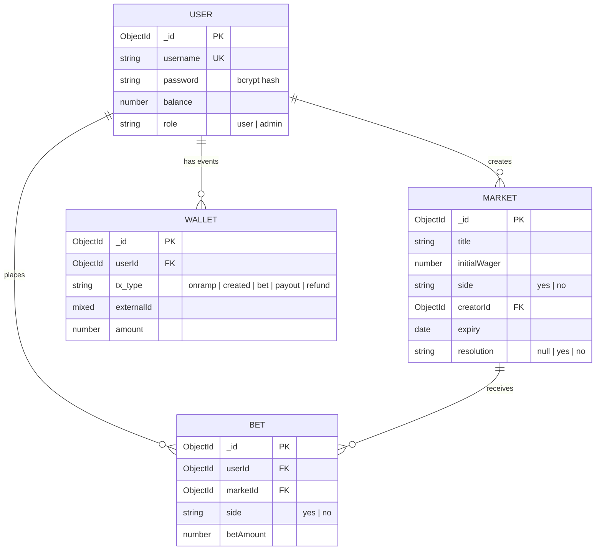

# mini-kalshi

A prediction-market backend inspired by [Kalshi](https://kalshi.com). Users deposit (fake) money, create yes/no markets by staking a wager, other users bet against the creator, and an admin resolves the market after it expires — payouts are then settled automatically.

## Table of Contents

- [How a market works](#how-a-market-works)
- [Tech stack](#tech-stack)
- [Project structure](#project-structure)
- [Getting started](#getting-started)
- [Database schema](#database-schema)
- [Authentication](#authentication)
- [API reference](#api-reference)
- [Example flow](#example-flow)

---

## How a market works

1. **Create** — A user opens a market with a `title`, picks a `side` (`yes` / `no`), sets an `expiry` date and stakes an `initialWager`. The wager is debited from their balance immediately.
2. **Bet** — Other users bet on the **opposite** side of the creator. Bets are matched 1:1 against the creator's wager, so the sum of all bets on a market can never exceed `initialWager`. The creator cannot bet on their own market.
3. **Resolve** — After `expiry`, an admin resolves the market as `yes` or `no`.
4. **Payout**
   - **Creator's side wins** → creator receives `initialWager + totalBets` (their own stake back, plus all the bettors' stakes).
   - **Bettors' side wins** → every bettor receives `2 × betAmount`; the creator is refunded the unmatched part of the wager (`initialWager − totalBets`) if it is greater than 0.

**Example:** creator stakes `100` on `yes`; two users bet `40` and `30` on `no` (`totalBets = 70`).

| Outcome | Creator | Bettors |
| --- | --- | --- |
| Resolves `yes` | +170 (100 + 70) | lose their stakes |
| Resolves `no` | +30 (refund of unmatched wager) | +80 and +60 |

All money amounts are positive integers.

---

## Tech stack

| Layer | Tech |
| --- | --- |
| Runtime | [Bun](https://bun.com) |
| Language | TypeScript |
| Framework | Express 5 |
| Database | MongoDB via Mongoose |
| Validation | Zod |
| Auth | JWT (`jsonwebtoken`) + `bcrypt` password hashing |

---

## Project structure

```
mini-kalshi/
├── index.ts                      # Express app bootstrap + route mounting
└── src/
    ├── config/
    │   ├── config.ts             # Loads JWT secret (throws if missing)
    │   └── db.ts                 # MongoDB connection
    ├── controller/
    │   ├── authController.ts     # register, login, onramp, profile, transactions
    │   ├── marketController.ts   # create market, list markets, place bet, my bets
    │   └── resolveController.ts  # resolve market + settle payouts
    ├── middleware/
    │   ├── authMiddleware.ts     # verifies JWT, sets req.user
    │   └── adminMiddleware.ts    # requires role === "admin"
    ├── models/                   # Mongoose schemas (User, Market, Bet, Wallet)
    ├── routes/                   # Express routers
    └── types/                    # Zod validators + Express type augmentation
```

---

## Getting started

### Prerequisites

- [Bun](https://bun.com) installed
- A running MongoDB instance (local or Atlas)

### Environment variables

Create a `.env` file in the project root:

```env
DATABASE_URL=mongodb://localhost:27017/mini-kalshi
JWT_USER_SECRET=replace-with-a-long-random-string
PORT=3002
```

| Variable | Required | Description |
| --- | --- | --- |
| `DATABASE_URL` | Yes | MongoDB connection string |
| `JWT_USER_SECRET` | Yes | Secret used to sign JWTs. The app throws on startup if it is missing |
| `PORT` | No | HTTP port (default `3002`) |

### Install and run

```bash
bun install
bun run index.ts
```

The API is then available at `http://localhost:3002/api/v1`.

---

## Database schema

MongoDB, accessed through Mongoose. The four models map to the collections `users`, `markets`, `bets` and `wallets`. Every document also has Mongoose's default `_id` and `__v`.



### `users`

| Field | Type | Required | Default | Notes |
| --- | --- | --- | --- | --- |
| `username` | String | Yes | — | **Unique** |
| `password` | String | Yes | — | bcrypt hash (10 salt rounds) |
| `balance` | Number | — | `0` | Spendable balance |
| `role` | String | Yes | `"user"` | Enum: `user`, `admin` |

### `markets`

| Field | Type | Required | Default | Notes |
| --- | --- | --- | --- | --- |
| `title` | String | Yes | — | The question / statement being predicted |
| `initialWager` | Number | Yes | — | Creator's stake; also the cap on total bets |
| `side` | String | Yes | — | **Creator's** side. Enum: `yes`, `no` |
| `creatorId` | ObjectId → `User` | Yes | — | |
| `expiry` | Date | Yes | — | Betting closes here; resolution is allowed only after it |
| `resolution` | String | — | `null` | `null` while open; set to `yes` or `no` once resolved |

### `bets`

| Field | Type | Required | Notes |
| --- | --- | --- | --- |
| `userId` | ObjectId → `User` | Yes | The bettor |
| `marketId` | ObjectId → `Market` | Yes | |
| `side` | String | Yes | Enum: `yes`, `no`. Set by the server — always the opposite of the market's `side` |
| `betAmount` | Number | Yes | Positive integer |

### `wallets` (ledger of balance changes)

Every balance change writes one event here. `amount` is signed: negative = debit, positive = credit.

| Field | Type | Required | Notes |
| --- | --- | --- | --- |
| `userId` | ObjectId → `User` | Yes | |
| `tx_type` | String | Yes | Enum: `onramp`, `created`, `bet`, `payout`, `refund` |
| `externalId` | Mixed | — | Reference to the related market / bet (see below) |
| `amount` | Number | — | Signed amount |

What each `tx_type` looks like:

| `tx_type` | Written when | `externalId` | `amount` |
| --- | --- | --- | --- |
| `onramp` | User adds funds | *(not set)* | `+amount` |
| `created` | User creates a market | `{ marketId }` | `−initialWager` |
| `bet` | User places a bet | `{ betId, marketId }` | `−betAmount` |
| `payout` | Market resolved — creator wins | `{ marketId }` | `+(initialWager + totalBets)` |
| `payout` | Market resolved — bettor wins | `{ marketId, betId }` | `+(2 × betAmount)` |
| `refund` | Market resolved — bettors win, wager partly unmatched | `{ marketId }` | `+(initialWager − totalBets)` |

### Indexes

Only the defaults: `_id` on every collection and the unique index on `users.username`.

---

## Authentication

Protected routes need a JWT in the `Authorization` header:

```
Authorization: Bearer <token>
```

- A token is issued by `POST /api/v1/auth/login` and is valid for **2 hours**.
- The token payload contains only the user's `id`.
- The **admin-only** route additionally loads the user from the database and requires `role === "admin"`.

| Situation | Status | Body |
| --- | --- | --- |
| No `Authorization` token | `401` | `{ "messege": "Unauthorized" }` *(sic — key is spelled `messege`)* |
| Invalid / expired token | `401` | `{ "message": "Unauthorized" }` |
| Not an admin (admin routes) | `403` | `{ "message": "Admin access required" }` |

---

## API reference

**Base URL:** `http://localhost:3002/api/v1`

All request and response bodies are JSON (`Content-Type: application/json`).

| Method | Endpoint | Auth | Description |
| --- | --- | --- | --- |
| `POST` | [`/auth/register`](#post-authregister) | — | Create an account |
| `POST` | [`/auth/login`](#post-authlogin) | — | Log in, receive a JWT |
| `POST` | [`/auth/onramp`](#post-authonramp) | User | Add (fake) funds to balance |
| `GET` | [`/auth/profile`](#get-authprofile) | User | Get own profile and balance |
| `GET` | [`/auth/transactions`](#get-authtransactions) | User | Get own wallet events |
| `POST` | [`/market`](#post-market) | User | Create a market |
| `GET` | [`/market`](#get-market) | — | List all markets |
| `POST` | [`/market/bet`](#post-marketbet) | User | Bet on a market |
| `GET` | [`/market/bets`](#get-marketbets) | User | List own bets |
| `POST` | [`/resolve`](#post-resolve) | Admin | Resolve an expired market and settle payouts |

### Error format

Validation failures return `400` with `{ "message": "Incorrect Format" }`. Unexpected failures return `500` with `{ "message": "Internal Serever Error" }`. Business-rule errors use either a `message` or an `error` key, as listed per endpoint below.

---

### Auth

#### `POST /auth/register`

Create a new user.

**Body**

| Field | Type | Rules |
| --- | --- | --- |
| `username` | string | min 3 characters, must be unique |
| `password` | string | min 6 characters |
| `role` | string | required; `"user"` or `"admin"` |

```json
{ "username": "alice", "password": "secret123", "role": "user" }
```

**Responses**

| Status | Body |
| --- | --- |
| `201` | `{ "message": "User Registerd Sucessfully" }` |
| `400` | `{ "message": "Incorrect Format" }` |
| `409` | `{ "message": "User Already Exists" }` |

---

#### `POST /auth/login`

**Body**

| Field | Type |
| --- | --- |
| `username` | string |
| `password` | string |

**Responses**

| Status | Body |
| --- | --- |
| `200` | `{ "token": "<jwt>" }` |
| `400` | `{ "message": "Incorrect Format" }` |
| `401` | `{ "message": "Incorrect Credentials" }` |
| `403` | `{ "message": "User Doesn't Exits, Please SignUp !!" }` |

---

#### `POST /auth/onramp`

Adds funds to the authenticated user's balance and records an `onramp` wallet event.

**Body**

| Field | Type | Rules |
| --- | --- | --- |
| `amount` | number | positive integer |

**Responses**

| Status | Body |
| --- | --- |
| `200` | `{ "balance": 500 }` — new balance |
| `400` | `{ "message": "Incorrect Format" }` |
| `404` | `{ "error": "User not found" }` |

---

#### `GET /auth/profile`

Returns the authenticated user (without the password hash).

**Response `200`**

```json
{
  "user": {
    "_id": "6ae22e279a09e824291ee7b0",
    "username": "alice",
    "balance": 500,
    "role": "user",
    "__v": 0
  }
}
```

Errors: `404` `{ "error": "User not found" }`

---

#### `GET /auth/transactions`

Returns all wallet events for the authenticated user.

**Response `200`**

```json
{
  "Transactions": [
    { "_id": "…", "userId": "…", "tx_type": "onramp", "amount": 500, "__v": 0 },
    {
      "_id": "…",
      "userId": "…",
      "tx_type": "created",
      "externalId": { "marketId": "…" },
      "amount": -100,
      "__v": 0
    }
  ]
}
```

> The top-level key is `Transactions` (capital T).

---

### Markets

#### `POST /market`

Create a market. The `initialWager` is deducted from the creator's balance and a `created` wallet event is recorded.

**Body**

| Field | Type | Rules |
| --- | --- | --- |
| `title` | string | min 3 characters |
| `initialWager` | number | positive integer, must be ≤ current balance |
| `side` | string | `"yes"` or `"no"` — the creator's side |
| `expiry` | date | ISO date string; must be in the future |

```json
{
  "title": "Will BTC close above $100k on 31 Dec?",
  "initialWager": 100,
  "side": "yes",
  "expiry": "2026-12-31T23:59:59.000Z"
}
```

**Responses**

| Status | Body |
| --- | --- |
| `201` | `{ "id": "<marketId>" }` |
| `400` | `{ "message": "Incorrect Format" }` |
| `400` | `{ "message": "Expiry must be in the future" }` |
| `400` | `{ "error": "Insufficient Balance" }` |

---

#### `GET /market`

Public. Returns every market, with the creator's username populated.

**Response `200`**

```json
{
  "markets": [
    {
      "_id": "…",
      "title": "Will BTC close above $100k on 31 Dec?",
      "initialWager": 100,
      "side": "yes",
      "creatorId": { "_id": "…", "username": "alice" },
      "expiry": "2026-12-31T23:59:59.000Z",
      "resolution": null,
      "__v": 0
    }
  ]
}
```

---

#### `POST /market/bet`

Bet against the creator. The server assigns the bet to the **opposite** side of the market's `side`, deducts `amount` from the bettor's balance and records a `bet` wallet event.

**Body**

| Field | Type | Rules |
| --- | --- | --- |
| `marketId` | string | ID of an existing market |
| `amount` | number | positive integer, must be ≤ bettor's balance |

```json
{ "marketId": "6ae22e279a09e824291ee7b0", "amount": 40 }
```

**Responses**

| Status | Body | Reason |
| --- | --- | --- |
| `201` | `{ "betId": "<betId>" }` | Bet placed |
| `400` | `{ "message": "Incorrect Format" }` | Invalid body |
| `404` | `{ "error": "Market not found" }` | |
| `400` | `{ "error": "Market already resolved" }` | |
| `400` | `{ "error": "Market expired" }` | `now >= expiry` |
| `400` | `{ "error": "Creator cannot bet against their own market" }` | |
| `400` | `{ "error": "Bet exceeds remaining available amount" }` | Total bets would exceed `initialWager` |
| `404` | `{ "error": "User not found" }` | |
| `400` | `{ "error": "Insufficient balance" }` | |

---

#### `GET /market/bets`

Returns the authenticated user's bets, with each `marketId` populated with the full market document.

**Response `200`**

```json
{
  "bets": [
    {
      "_id": "…",
      "userId": "…",
      "marketId": {
        "_id": "…",
        "title": "Will BTC close above $100k on 31 Dec?",
        "initialWager": 100,
        "side": "yes",
        "creatorId": "…",
        "expiry": "2026-12-31T23:59:59.000Z",
        "resolution": null,
        "__v": 0
      },
      "side": "no",
      "betAmount": 40,
      "__v": 0
    }
  ]
}
```

---

### Resolution

#### `POST /resolve`

**Admin only.** Resolves an expired market and settles all payouts (see [How a market works](#how-a-market-works)). Writes `payout` / `refund` wallet events for every credited user.

**Body**

| Field | Type | Rules |
| --- | --- | --- |
| `marketId` | string | ID of an existing market |
| `resolution` | string | `"yes"` or `"no"` — the actual outcome |

```json
{ "marketId": "6ae22e279a09e824291ee7b0", "resolution": "no" }
```

**Responses**

| Status | Body |
| --- | --- |
| `200` | `{ "message": "Market resolved successfully", "resolution": "no" }` |
| `400` | `{ "message": "Incorrect Format" }` |
| `404` | `{ "error": "Market not found" }` |
| `400` | `{ "error": "Market already resolved" }` |
| `400` | `{ "error": "Market has not expired yet" }` |
| `401` / `403` | Not authenticated / not an admin (see [Authentication](#authentication)) |

---

## Example flow

```bash
BASE=http://localhost:3002/api/v1

# 1. Register an admin and two users
curl -X POST $BASE/auth/register -H "Content-Type: application/json" \
  -d '{"username":"admin","password":"secret123","role":"admin"}'
curl -X POST $BASE/auth/register -H "Content-Type: application/json" \
  -d '{"username":"alice","password":"secret123","role":"user"}'
curl -X POST $BASE/auth/register -H "Content-Type: application/json" \
  -d '{"username":"bob","password":"secret123","role":"user"}'

# 2. Log in as alice and bob
ALICE=$(curl -s -X POST $BASE/auth/login -H "Content-Type: application/json" \
  -d '{"username":"alice","password":"secret123"}' | jq -r .token)
BOB=$(curl -s -X POST $BASE/auth/login -H "Content-Type: application/json" \
  -d '{"username":"bob","password":"secret123"}' | jq -r .token)

# 3. Fund both accounts
curl -X POST $BASE/auth/onramp -H "Authorization: Bearer $ALICE" \
  -H "Content-Type: application/json" -d '{"amount":500}'
curl -X POST $BASE/auth/onramp -H "Authorization: Bearer $BOB" \
  -H "Content-Type: application/json" -d '{"amount":500}'

# 4. Alice creates a market (stakes 100 on "yes")
MARKET=$(curl -s -X POST $BASE/market -H "Authorization: Bearer $ALICE" \
  -H "Content-Type: application/json" \
  -d '{"title":"Will it rain tomorrow?","initialWager":100,"side":"yes","expiry":"2026-12-31T23:59:59Z"}' \
  | jq -r .id)

# 5. Bob bets 40 against her (on "no")
curl -X POST $BASE/market/bet -H "Authorization: Bearer $BOB" \
  -H "Content-Type: application/json" \
  -d "{\"marketId\":\"$MARKET\",\"amount\":40}"

# 6. After the market expires, the admin resolves it
ADMIN=$(curl -s -X POST $BASE/auth/login -H "Content-Type: application/json" \
  -d '{"username":"admin","password":"secret123"}' | jq -r .token)
curl -X POST $BASE/resolve -H "Authorization: Bearer $ADMIN" \
  -H "Content-Type: application/json" \
  -d "{\"marketId\":\"$MARKET\",\"resolution\":\"no\"}"

# 7. Check the ledger
curl $BASE/auth/transactions -H "Authorization: Bearer $BOB"
```