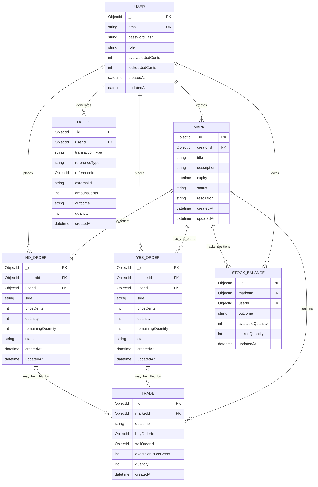

# Kalshi-Style Prediction Market — Database Schema

This document describes the database structure for the Kalshi-style market assignment.

## 1. Design decision: separate YES and NO order collections

This schema uses two separate collections for orders:

- `yes_orders` — BUY YES and SELL YES orders.
- `no_orders` — BUY NO and SELL NO orders.

Each collection stores both sides (`BUY` and `SELL`). The order book for an outcome is built by querying that collection for a market and sorting/grouping orders by price and side. A separate `OrderBook` collection is not required unless you want to persist order-book snapshots or aggregated price levels.

> **Important:** YES and NO are two outcomes of the same market. Each outcome has its own order book, but both books belong to the same `Market` document.

## 2. Entity relationship diagram



**Relationship note:** `TRADE.buyOrderId` and `TRADE.sellOrderId` refer to documents in `yes_orders` when `outcome` is `YES`, and in `no_orders` when `outcome` is `NO`. This is a polymorphic reference; MongoDB does not enforce it as a foreign key, so validate it in the service layer.

## 3. Collections and fields

### 3.1 `users`

Stores account information and cash balances.

| Field | Type | Description |
|---|---|---|
| `_id` | ObjectId | Primary identifier |
| `email` | String | Unique user email |
| `passwordHash` | String | Hashed password; never store a plain-text password |
| `role` | String | For example, `USER` or `ADMIN` |
| `availableUsdCents` | Number | Cash available to spend or withdraw |
| `lockedUsdCents` | Number | Cash reserved for open BUY orders |
| `createdAt`, `updatedAt` | Date | Timestamps |

Store money as integer cents (or the smallest supported currency unit), not JavaScript floating-point values.

### 3.2 `markets`

Stores the question/event users can trade on.

| Field | Type | Description |
|---|---|---|
| `_id` | ObjectId | Primary identifier |
| `creatorId` | ObjectId | References `users._id` |
| `title` | String | Market question |
| `description` | String | Optional details and resolution criteria |
| `expiry` | Date | Trading expiry time |
| `status` | String | For example, `OPEN`, `CLOSED`, `RESOLVED`, `CANCELLED` |
| `resolution` | String | `YES`, `NO`, or `null` until resolved |
| `createdAt`, `updatedAt` | Date | Timestamps |

### 3.3 `yes_orders`

Contains BUY YES and SELL YES orders.

### 3.4 `no_orders`

Contains BUY NO and SELL NO orders.

Both order collections use the same fields:

| Field | Type | Description |
|---|---|---|
| `_id` | ObjectId | Order identifier |
| `marketId` | ObjectId | References `markets._id` |
| `userId` | ObjectId | References `users._id` |
| `side` | String | `BUY` or `SELL` |
| `priceCents` | Number | Limit price in cents; usually 1–99 for a $1 binary contract |
| `quantity` | Number | Original number of contracts |
| `remainingQuantity` | Number | Quantity not yet filled |
| `status` | String | `OPEN`, `PARTIALLY_FILLED`, `FILLED`, `CANCELLED`, or `REJECTED` |
| `createdAt`, `updatedAt` | Date | Timestamps |

Example documents:

```js
// yes_orders
{
  marketId: ObjectId("..."),
  userId: ObjectId("..."),
  side: "BUY",
  priceCents: 60,
  quantity: 10,
  remainingQuantity: 10,
  status: "OPEN"
}

// no_orders
{
  marketId: ObjectId("..."),
  userId: ObjectId("..."),
  side: "SELL",
  priceCents: 40,
  quantity: 5,
  remainingQuantity: 5,
  status: "OPEN"
}
```

An order book is queried per market and outcome. For example, the YES book reads from `yes_orders` and separates `side: BUY` bids from `side: SELL` asks. The NO book does the same using `no_orders`.

### 3.5 `stock_balances`

Stores each user's available and reserved contracts for a market outcome.

| Field | Type | Description |
|---|---|---|
| `_id` | ObjectId | Primary identifier |
| `marketId` | ObjectId | References `markets._id` |
| `userId` | ObjectId | References `users._id` |
| `outcome` | String | `YES` or `NO` |
| `availableQuantity` | Number | Contracts available to sell or merge |
| `lockedQuantity` | Number | Contracts reserved by open SELL orders |
| `updatedAt` | Date | Last balance update |

Create a unique compound index on `{ userId: 1, marketId: 1, outcome: 1 }` so a user has one balance document per outcome in each market.

### 3.6 `trades`

Stores completed matches. One order may be filled by multiple trades (partial fills), so a trade is a separate record for each execution.

| Field | Type | Description |
|---|---|---|
| `_id` | ObjectId | Trade identifier |
| `marketId` | ObjectId | References `markets._id` |
| `outcome` | String | `YES` or `NO` |
| `buyOrderId` | ObjectId | ID from the matching outcome's order collection |
| `sellOrderId` | ObjectId | ID from the matching outcome's order collection |
| `executionPriceCents` | Number | Actual matched price in cents |
| `quantity` | Number | Contracts executed |
| `createdAt` | Date | Execution time |

### 3.7 `tx_logs`

Stores an auditable history of cash and position changes.

| Field | Type | Description |
|---|---|---|
| `_id` | ObjectId | Transaction-log identifier |
| `userId` | ObjectId | References `users._id` |
| `transactionType` | String | For example, `ONRAMP`, `ORDER_LOCK`, `ORDER_RELEASE`, `TRADE`, `SPLIT`, `MERGE`, `PAYOUT`, `REFUND` |
| `referenceType` | String | For example, `ORDER`, `TRADE`, `MARKET`, `PAYMENT` |
| `referenceId` | ObjectId | Related document ID, when applicable |
| `externalId` | String | External payment/provider identifier, when applicable |
| `amountCents` | Number | Cash change in cents; positive or negative |
| `outcome` | String | `YES`, `NO`, or `null` for cash-only events |
| `quantity` | Number | Contract quantity change, when applicable |
| `createdAt` | Date | Event time |

For robust auditing, use separate ledger entries for cash movements and position movements, or use a ledger schema that explicitly records both asset type and signed quantity. Do not rely only on the current balance documents as transaction history.

## 4. Indexes

Recommended starting indexes for MongoDB:

```js
// users
userSchema.index({ email: 1 }, { unique: true });

// markets
marketSchema.index({ creatorId: 1, createdAt: -1 });
marketSchema.index({ status: 1, expiry: 1 });

// yes_orders and no_orders (add to both schemas)
orderSchema.index({ marketId: 1, status: 1, side: 1, priceCents: 1, createdAt: 1 });
orderSchema.index({ userId: 1, status: 1, createdAt: -1 });

// stock_balances
stockBalanceSchema.index(
  { userId: 1, marketId: 1, outcome: 1 },
  { unique: true }
);

// trades
tradeSchema.index({ marketId: 1, outcome: 1, createdAt: -1 });
tradeSchema.index({ buyOrderId: 1 });
tradeSchema.index({ sellOrderId: 1 });

// tx_logs
 txLogSchema.index({ userId: 1, createdAt: -1 });
txLogSchema.index({ externalId: 1 }, { sparse: true });
```

For price-time priority, the matching engine should sort BUY orders by highest price first and SELL orders by lowest price first, then use creation time (or a monotonically increasing sequence) to break ties. Validate the actual query plan and refine indexes as the matching workload becomes clear.

## 5. How locking works

### BUY order

When a user places a BUY order, reserve cash based on the limit price and remaining quantity:

```text
reservedCash = priceCents * quantity
```

Move that amount from `availableUsdCents` to `lockedUsdCents`. When the order is partially filled, debit the actual trade cost and release any excess reservation according to your order-reservation policy. When the order is cancelled, release the reservation for its unfilled quantity.

### SELL order

When a user places a SELL YES order, move the requested quantity from the user's YES `availableQuantity` to YES `lockedQuantity` in `stock_balances`. For SELL NO, do the same for the NO balance. Filled contracts are deducted from the locked amount; cancellation releases the unfilled amount.

## 6. Split, merge, and resolution

For a binary contract with a $1 payout:

- **Split:** consume $1.00 (100 cents) and issue 1 YES contract plus 1 NO contract. For quantity `q`, consume `100 * q` cents and credit `q` YES and `q` NO contracts.
- **Merge:** consume 1 YES plus 1 NO contract and return $1.00 (100 cents). For quantity `q`, debit `q` YES and `q` NO and credit `100 * q` cents.
- **Resolve YES:** each winning YES contract pays 100 cents; NO pays 0.
- **Resolve NO:** each winning NO contract pays 100 cents; YES pays 0.

These balance changes, order fills, and ledger records must be committed atomically. Use MongoDB transactions where supported (replica set or sharded cluster), and make payment/webhook and order-processing operations idempotent.

## 7. Integrity rules to enforce in the service layer

1. An order's `marketId` must reference an existing market that is still open and before expiry.
2. A YES order must be stored only in `yes_orders`; a NO order must be stored only in `no_orders`.
3. `side` must be either `BUY` or `SELL`.
4. `priceCents` must be an integer in the permitted contract price range (commonly 1–99).
5. `quantity` must be a positive integer and `remainingQuantity` must be between 0 and `quantity`.
6. A user cannot sell more contracts than their available position.
7. A user cannot place a BUY order unless sufficient cash can be reserved.
8. A trade must match orders for the same market and same outcome, with compatible BUY/SELL prices.
9. Update balances, order quantities/statuses, trades, and ledger entries atomically to prevent double spending or overselling.
10. Enforce idempotency for payment callbacks and any retried order/settlement requests.

## 8. Summary of relationships

| Parent | Child | Cardinality |
|---|---|---|
| `users` | `markets` | 1 : many (creator) |
| `markets` | `yes_orders` | 1 : many |
| `markets` | `no_orders` | 1 : many |
| `users` | `yes_orders` | 1 : many |
| `users` | `no_orders` | 1 : many |
| `users` | `stock_balances` | 1 : many |
| `markets` | `stock_balances` | 1 : many |
| `markets` | `trades` | 1 : many |
| `users` | `tx_logs` | 1 : many |

**Implementation note:** MongoDB references are application-level relationships, not enforced relational foreign keys. Validate referenced documents and use transactions for multi-document state changes.
